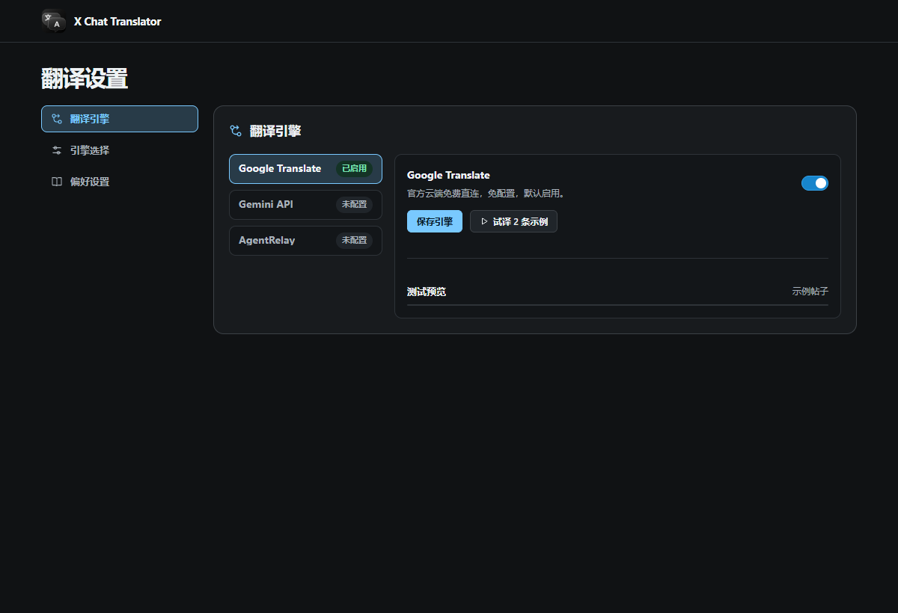
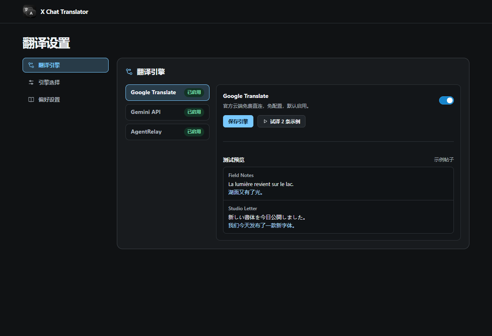
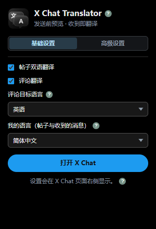
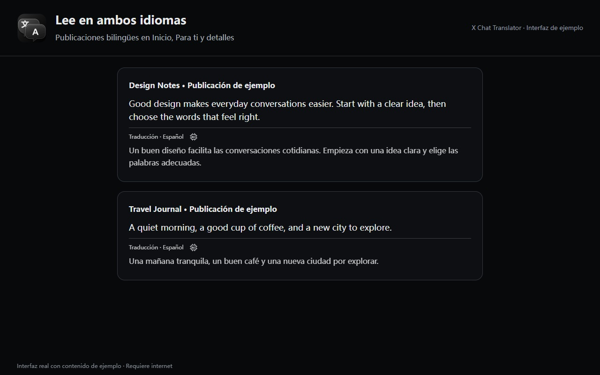
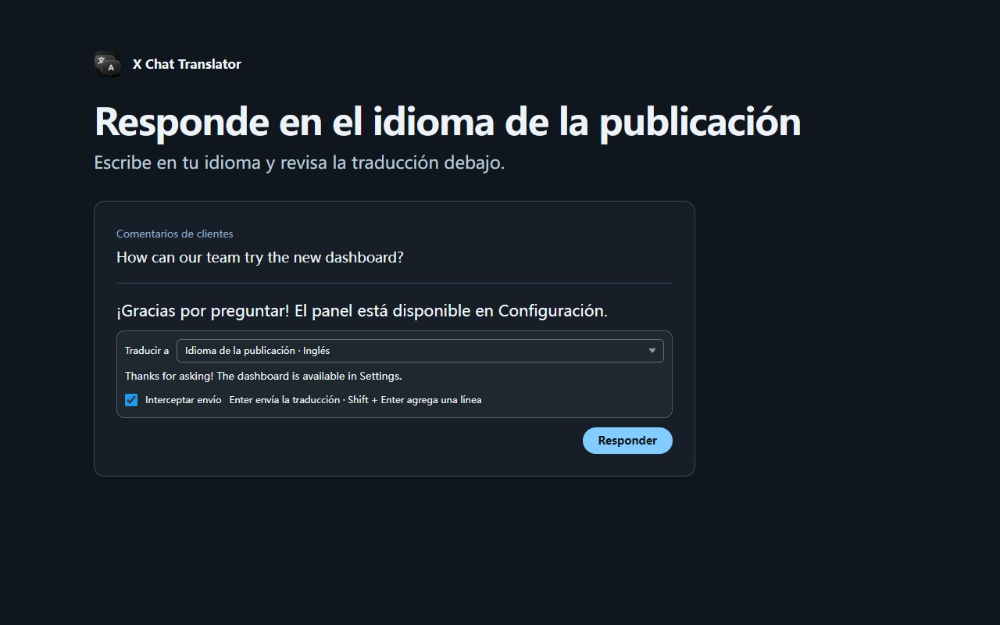
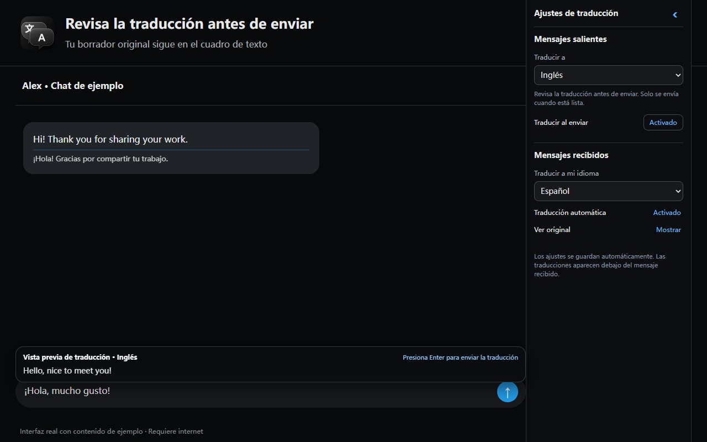

# X Chat Translator

[English](README.md) | [简体中文](README.zh-CN.md) | [日本語](README.ja.md) | **Español**

**Versión:** `1.7.1` · **Chrome Web Store:** [Twitter Translator for X – Tweets & DMs](https://chromewebstore.google.com/detail/dlijcpgpcmbnenmhpgijjhlhedhkmbmk) · **Sitio web:** [goodexts.com/es/x-chat-translator](https://goodexts.com/es/x-chat-translator)

Extensión Chrome MV3 para **X (Twitter)** que mantiene tu texto original intacto mientras traduce **publicaciones del timeline**, **borradores de respuestas** y **mensajes directos (DM) entrantes y salientes**, con asignación independiente de motores para cada escenario.

---

## Capturas de pantalla

### Configuración en dos columnas y asignación por escenario
Configura **Google Translate**, **Gemini API (BYOK)** y **AgentRelay** de forma independiente, realiza pruebas en vivo y asigna un motor distinto a Publicaciones, Respuestas, Chat entrante y Chat saliente.

| Motores de traducción | Asignación por escenario |
| :---: | :---: |
|  |  |

### Popup compacto y vistas previas en X.com
Popup con pestañas Básico / Avanzado e iconos `?` informativos, junto con tarjetas bilingües de publicaciones, vista previa de respuestas con cambio rápido de motor y vista previa en X Chat.

| Popup | Publicaciones | Respuestas | X Chat |
| :---: | :---: | :---: | :---: |
|  |  |  |  |

---

## Características principales

- **4 escenarios independientes**: elige distintos motores para Publicaciones, Respuestas, Chat entrante y Chat saliente, y cambia de motor al instante desde la cabecera de vista previa de respuesta.
- **3 motores disponibles**: **Google Translate** (gratuito, sin configuración), **Gemini API (BYOK)** (clave local, prueba de conexión, caché persistente en IndexedDB) y **AgentRelay** (detección e intercambio de token en un clic mediante Native Messaging `com.goodexts.agentrelay`).
- **Protección de escritura rápida e IME**: rebote de `900 ms`, cola de vuelo único (envía solo el último borrador al completarse la petición en curso), caché en memoria + IndexedDB y detección sin conexión con `LanguageDetector` (respaldo con `chrome.i18n.detectLanguage`).

## Privacidad y empaquetado

- Consulta [PRIVACY.md](PRIVACY.md) y [CHANGELOG.md](CHANGELOG.md).
