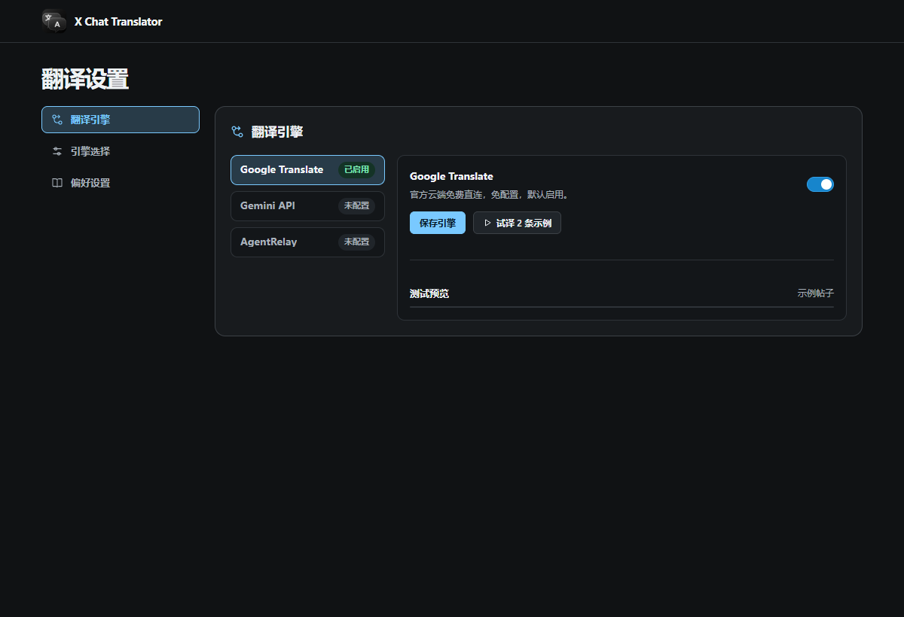
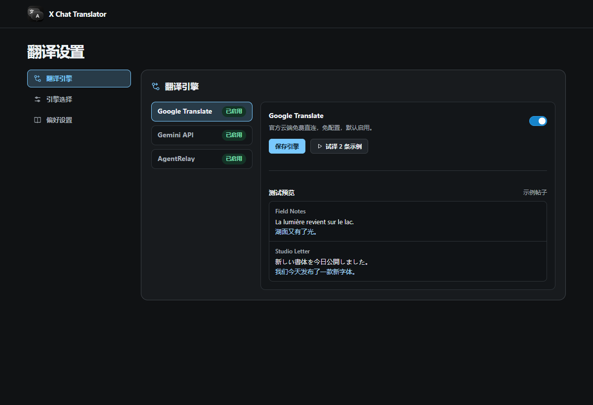
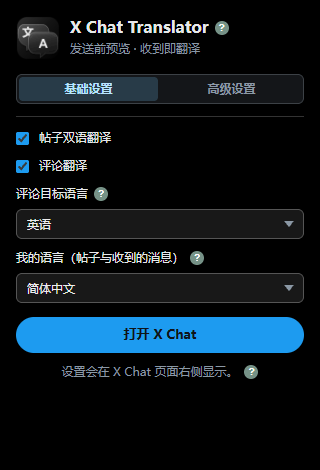
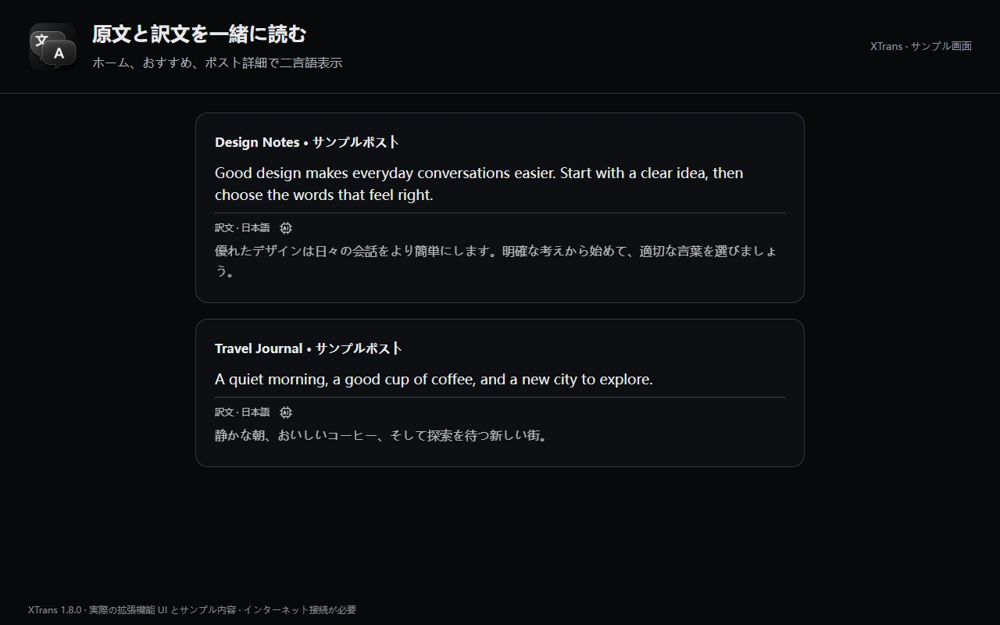
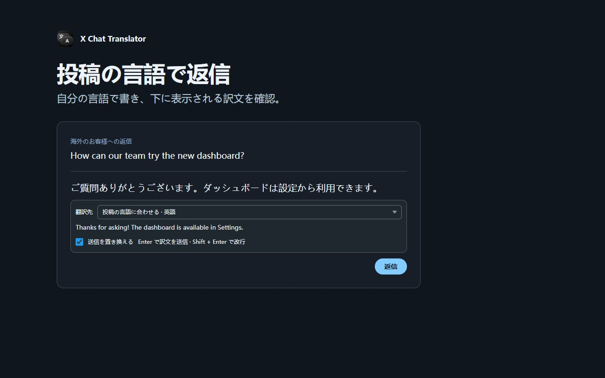
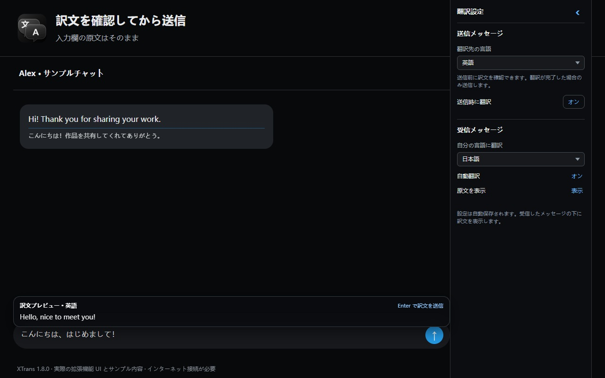

# X Chat Translator

[English](README.md) | [简体中文](README.zh-CN.md) | **日本語** | [Español](README.es.md)

**バージョン:** `1.7.1` · **Chrome ウェブストア:** [Twitter Translator for X – Tweets & DMs](https://chromewebstore.google.com/detail/dlijcpgpcmbnenmhpgijjhlhedhkmbmk) · **公式サイト:** [goodexts.com/x-chat-translator](https://goodexts.com/x-chat-translator)

**X (Twitter)** 向けの Chrome MV3 翻訳拡張機能です。原文を保持したまま、**タイムライン投稿のバイリンガル翻訳**、**返信下書きの送信前プレビュー**、**X Chat の受信・送信 DM 翻訳**に対応し、4 つのシーンごとに翻訳エンジンを個別に設定できます。

---

## スクリーンショット

### 2 カラム設定画面（翻訳エンジン＆シーン割り当て）
**Google Translate**、**Gemini API (BYOK)**、**AgentRelay** を個別に設定・テストでき、投稿・返信・DM 受信・DM 送信の 4 シーンに異なるエンジンを自由に割り当てられます。

| 翻訳エンジン設定 | シーン別エンジン割り当て |
| :---: | :---: |
|  |  |

### コンパクトなポップアップ＆実機プレビュー
基本設定・詳細設定タブと `?` ツールチップを備えたポップアップ、投稿バイリンガル表示、返信プレビュー（エンジン即時切替対応）、X Chat プレビューを提供します。

| ポップアップ | 投稿翻訳 | 返信プレビュー | X Chat プレビュー |
| :---: | :---: | :---: | :---: |
|  |  |  |  |

---

## 主な機能

- **4 シーン独立エンジン設定**：投稿・返信・DM 受信・DM 送信ごとに最適な翻訳エンジンを選択可能。返信プレビュー上部から即座にエンジンを切り替えて再翻訳もできます。
- **3 種類の翻訳エンジン**：
  - **Google Translate**：設定不要・無料でデフォルト有効。
  - **Gemini API (BYOK)**：API キーをブラウザにローカル保存し、接続テスト・モデル選択・IndexedDB 永続キャッシュに対応。
  - **AgentRelay**：Chrome Native Messaging（`com.goodexts.agentrelay`）経由でローカル AI サービスをワンクリック検出し、トークン連携を実行。
- **高速入力・IME 最適化とオフライン言語判定**：
  - `900 ms` デバウンス、単一実行ロック（応答待ち中は最新の下書きのみを送信）、メモリ＋IndexedDB キャッシュでトークン消費を抑制。
  - Chrome 内蔵オフライン `LanguageDetector` を優先利用し（`chrome.i18n.detectLanguage` フォールバック）、あらゆる言語コードの「投稿に合わせる」翻訳に対応。

## プライバシーとパッケージング

- 詳細は [PRIVACY.md](PRIVACY.md) および [CHANGELOG.md](CHANGELOG.md) をご覧ください。
