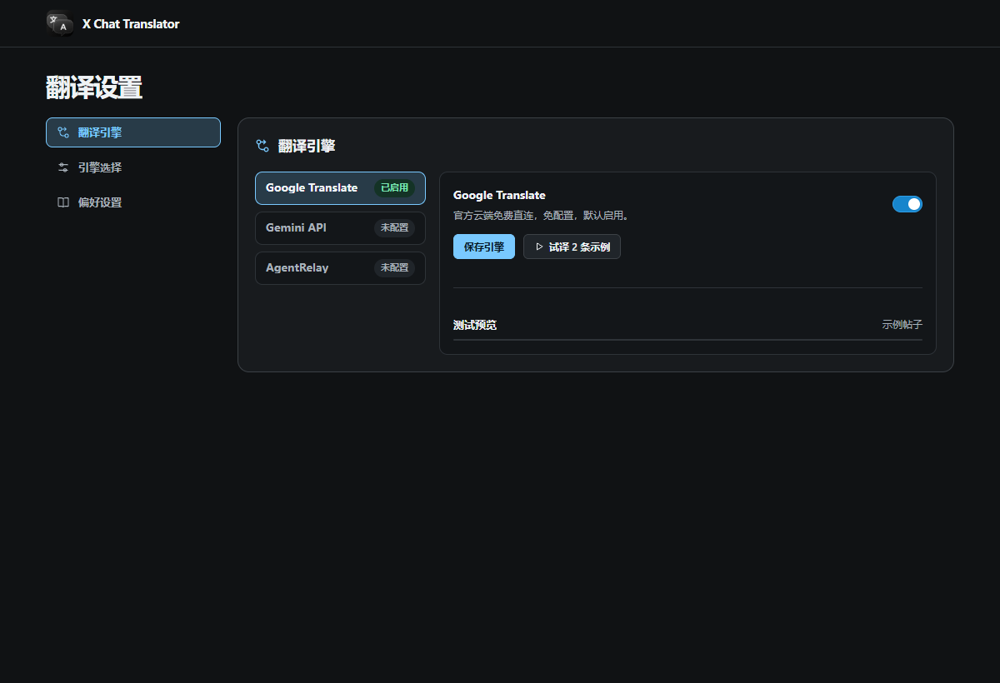
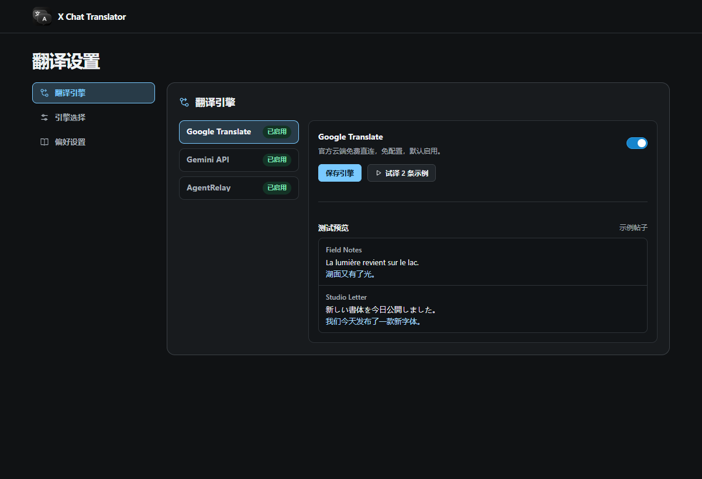
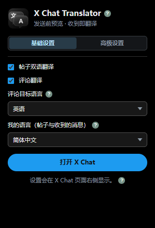
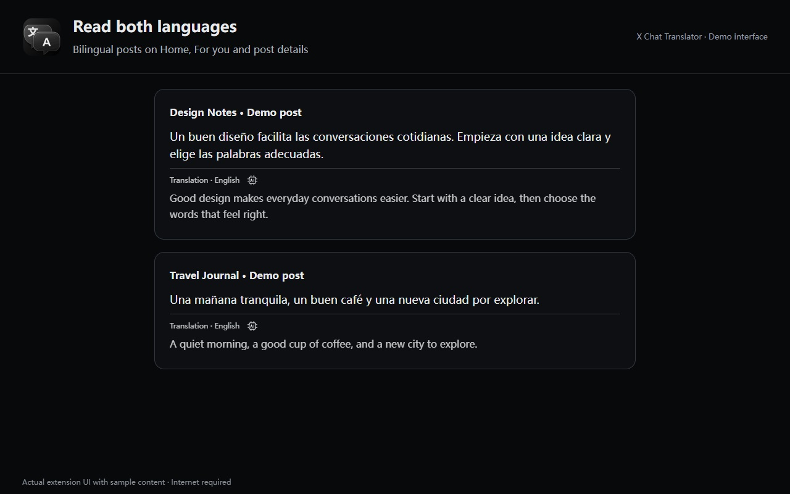
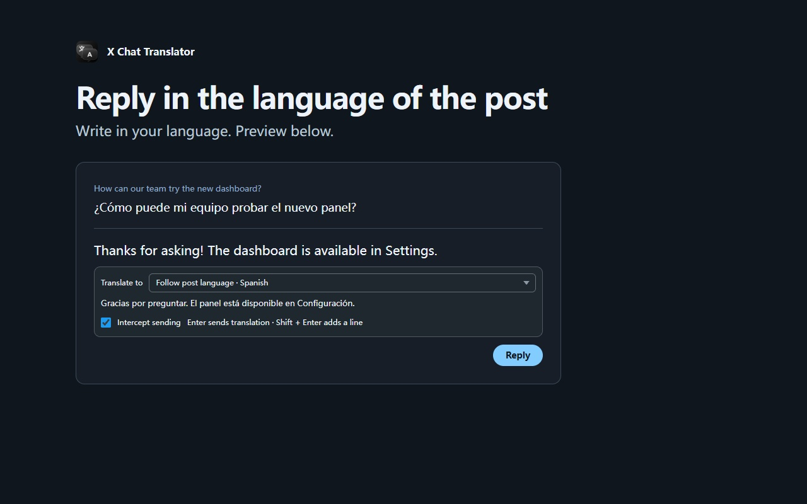
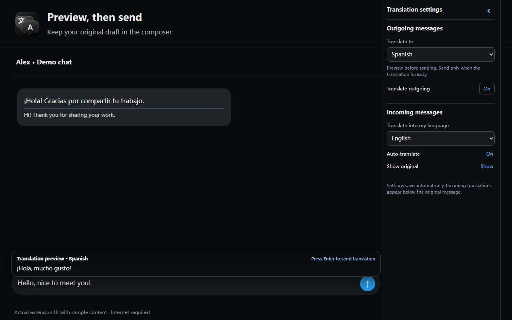

# X Chat Translator

**English** | [简体中文](README.zh-CN.md) | [日本語](README.ja.md) | [Español](README.es.md)

**Version:** `1.7.5` · **Chrome Web Store:** [Twitter Translator for X – Tweets & DMs](https://chromewebstore.google.com/detail/dlijcpgpcmbnenmhpgijjhlhedhkmbmk) · **Website:** [goodexts.com/x-chat-translator](https://goodexts.com/x-chat-translator)

A Chrome MV3 extension for **X (Twitter)** that keeps your original text intact while translating **timeline posts**, **reply drafts**, **incoming DMs**, and **outgoing DMs** — with independent engine routing across all four scenes.

---

## Screenshots

### Two-Column Engine Configuration & Scene Assignment
Configure **Google Translate**, **Gemini API (BYOK)**, and **AgentRelay** independently, test with live sample previews, and assign a separate engine to each of the four scenes (Posts, Replies, Chat Incoming, Chat Outgoing).

| Translation Engines | Scene Assignments |
| :---: | :---: |
|  |  |

### Compact Popup & Live X.com Previews
Quick toggles and language selectors with `?` hover tooltips in the toolbar popup, plus bilingual post cards, real-time reply translation preview, and X Chat DM preview.

| Toolbar Popup | Bilingual Posts | Reply Preview | X Chat DM Preview |
| :---: | :---: | :---: | :---: |
|  |  |  |  |

---

## Core Features

- **4-Scene Independent Engine Routing**: Choose different engines for **Posts**, **Replies**, **Chat Incoming**, and **Chat Outgoing** (plus a quick engine switcher directly inside the X.com reply preview).
- **3 Translation Engines**:
  - **Google Translate**: Free cloud translation, zero setup, enabled by default.
  - **Gemini API (BYOK)**: Bring your own Google AI Studio key, test connectivity in one click, choose models (default `gemini-flash-lite-latest`), and reuse persistent IndexedDB batch caching.
  - **AgentRelay**: Connect local AI clients (`Codex`, `Antigravity`, `Grok`, etc.) via Chrome Native Messaging (`com.goodexts.agentrelay`) with one-click detection and token exchange.
- **Smart Reply Translation & Draft Protection**:
  - Keeps your original text in the X.com reply editor and previews the translation below.
  - **Follow post** mode prioritizes Chrome's built-in offline `LanguageDetector` API (with `chrome.i18n.detectLanguage` fallback) and supports all ISO language codes (e.g. Vietnamese, Thai, Japanese, English).
  - **900 ms debounce**, single-flight AI serialization (`aiBusy`), latest-draft coalescing, and memory + IndexedDB caching minimize token consumption during fast typing and Chinese/Japanese IME input.
- **Appearance & Localization**: Light, Dark, and Default themes; 5 UI languages (`en`, `zh_CN`, `es_419`, `ja`, `ko`).

## Privacy & Local Packaging

- See [PRIVACY.md](PRIVACY.md) and [CHANGELOG.md](CHANGELOG.md).
- Run tests & build ZIP:
  ```powershell
  node tests/replies.test.cjs
  powershell -ExecutionPolicy Bypass -File tools/package.ps1
  ```
