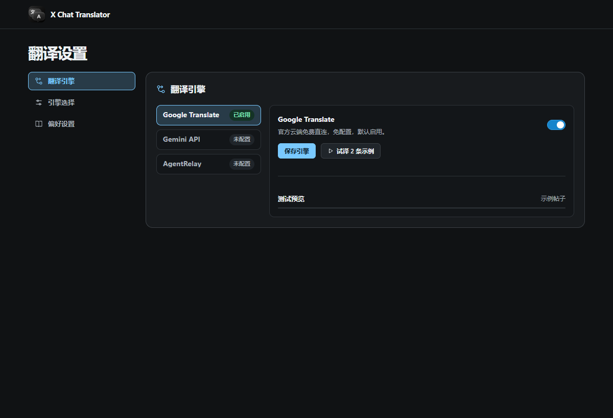
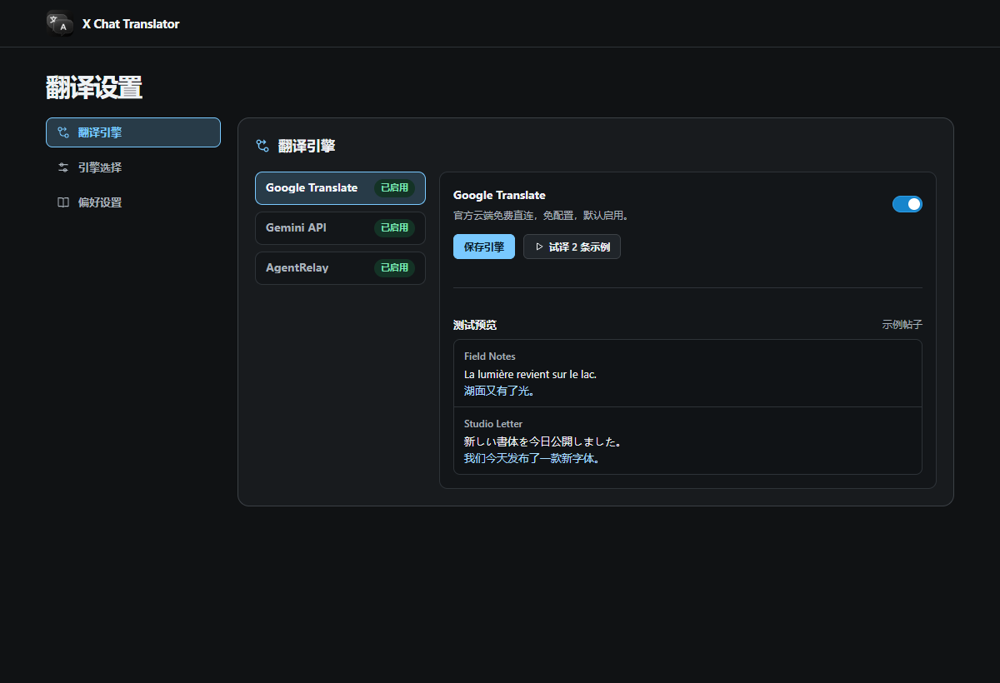
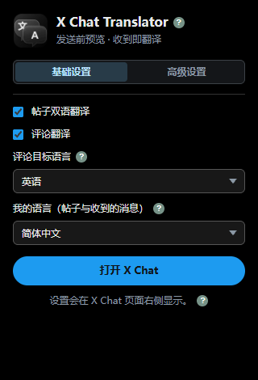
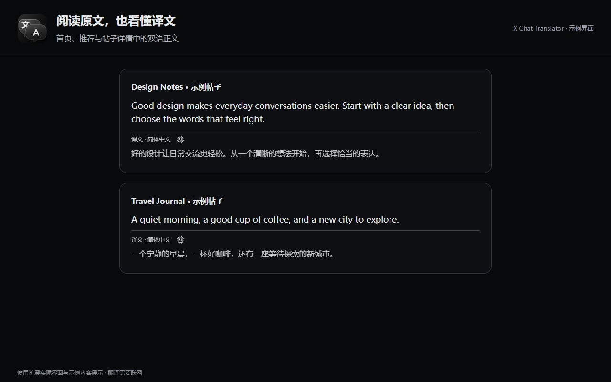
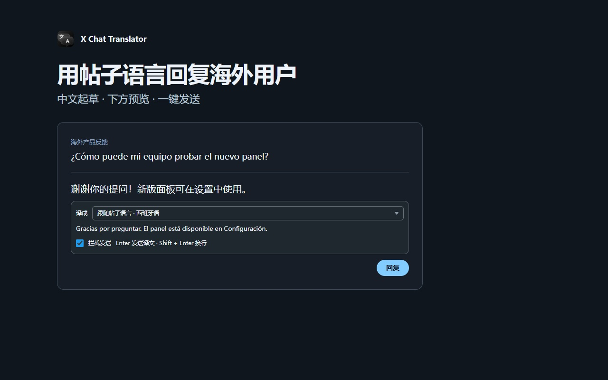
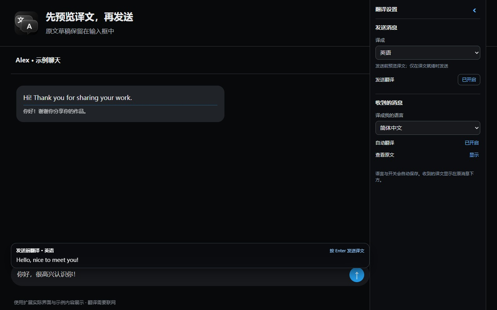

# X Chat Translator

[English](README.md) | **简体中文** | [日本語](README.ja.md) | [Español](README.es.md)

**当前版本：** `1.7.1` · **Chrome 应用商店：** [Twitter Translator for X – Tweets & DMs](https://chromewebstore.google.com/detail/dlijcpgpcmbnenmhpgijjhlhedhkmbmk) · **官网：** [goodexts.com/zh/x-chat-translator](https://goodexts.com/zh/x-chat-translator)

专为 **X (Twitter)** 打造的 Chrome MV3 翻译插件：保留原文不变，支持**帖子双语翻译**、**评论发送前实时预览**、**X Chat 收到私信即译**与**发送前译文预览**，并支持四个场景独立拆分配置翻译引擎。

---

## 界面截图

### 左右两栏引擎配置与四场景独立分配
支持分别配置 **Google Translate**、**Gemini API (BYOK)** 与 **AgentRelay**，内置两条示例试译预览；可将帖子、评论、私信收到、私信发送四个场景自由组合为不同引擎。

| 翻译引擎配置 | 场景独立分配 |
| :---: | :---: |
|  |  |

### 精简弹窗与 X.com 实机预览
工具栏弹窗支持“基础设置 | 高级设置”双 Tab 与圆圈问号悬浮提示；页面内提供帖子双语对照/原位替换、评论实时译文浮窗与 X Chat 私信预览。

| 工具栏弹窗 | 帖子双语翻译 | 评论译文浮窗 | X Chat 私信预览 |
| :---: | :---: | :---: | :---: |
|  |  |  |  |

---

## 核心特性

- **四场景引擎拆分**：帖子、评论、私信收到、私信发送均可独立指定翻译引擎；评论浮窗头部还支持**快速切换引擎并立即重译**。
- **三大翻译引擎**：
  - **Google Translate**：免费云端直连，免配置默认启用。
  - **Gemini API (BYOK)**：本地存储个人 Key，支持一键跳转 Google AI Studio 获取、连通性测试、模型切换（默认 `gemini-flash-lite-latest`）与 IndexedDB 持久缓存。
  - **AgentRelay**：通过 Chrome Native Messaging（`com.goodexts.agentrelay`）一键检测本机安装状态并交换访问令牌，直连本地 AI 会话翻译。
- **评论防抖、单飞与离线语种识别**：
  - 输入框始终保留原文，开启“拦截发送”后按 Enter 或点击回复自动改写本次发布请求为译文。
  - **跟随帖子**优先使用 Chrome 内置离线 `LanguageDetector`（`chrome.i18n.detectLanguage` 兜底），放开全语种识别（如越南语、日语等）。
  - Gemini / AgentRelay 支持 `900 ms` 防抖、AI 单飞锁（上一轮未返回不并发，仅取最新草稿发送）、`characterData` + `compositionend` 中文输入法兜底，以及内存与 IndexedDB 双层缓存。
- **主题与多语言**：支持“跟随默认 / 白天 / 黑夜”外观主题与 5 种界面语言（`zh_CN`、`en`、`ja`、`ko`、`es_419`）。

## 隐私与本地打包

- 详见 [PRIVACY.md](PRIVACY.md) 与 [CHANGELOG.md](CHANGELOG.md)。
- 本地验证与打包：
  ```powershell
  node tests/replies.test.cjs
  powershell -ExecutionPolicy Bypass -File tools/package.ps1
  ```
