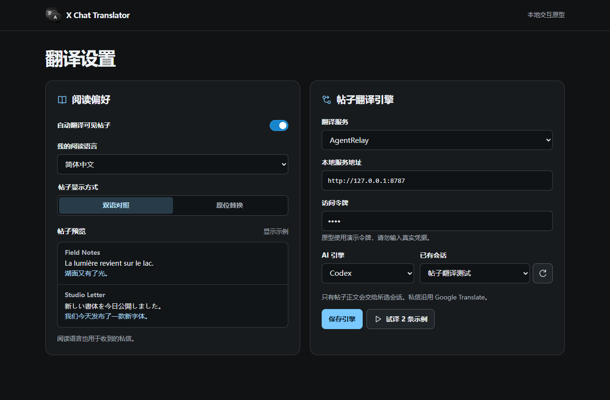

# X Chat Translator · 翻译设置与帖子批量翻译

2026-11-16 · 产品与接入设计稿

[打开可交互原型](options-prototype/index.html) · [桌面原型图](options-prototype/desktop.png) · [窄屏原型图](options-prototype/mobile.png)

## 从用户的一次阅读开始

用户在首页看到两条外语帖子，希望一次得到两条译文，又能随时核对其中一条的原文。建议把选择语言、决定怎样看帖放在设置页左栏，把选择翻译服务、确认服务可用放在右栏。实际阅读时，滚动仍由 X 控制，扩展在每条帖子自己的位置更新译文。

默认保留 Google Translate 和现有双语阅读方式。用户主动选择 AgentRelay 并保存后，才将可见帖子交给绑定的 AI 会话。第一期只试帖子和回复，私信收发继续走现有翻译链路。这样一次试验可以明确回答两个问题：一次调用能否返回多条可用译文，以及它们能否在列表变化后仍落到正确的帖子。



## 设置页与预览

| 位置 | 用户操作 | 生效范围 |
| --- | --- | --- |
| 入口 | popup 增加带悬停及焦点提示的设置图标，调用 `chrome.runtime.openOptionsPage()`；扩展详情页也可打开 | manifest 登记 `options_ui.page`，`open_in_tab: true` |
| 左栏 · 阅读偏好 | 开关自动翻译、选择阅读语言 | 即时保存，复用现有 `postsEnabled`、`incomingLanguage`。前者只影响帖子，后者也影响收到的消息。popup 与设置页监听相同键 |
| 左栏 · 帖子显示方式 | 双语对照／原位替换 | 新键 `postDisplayMode`，缺省双语。切换只重绘已有结果。原位模式逐帖提供「查看原文／查看译文」；关闭翻译立即还原 |
| 左栏 · 帖子预览 | 用两条固定示例查看当前阅读效果 | 示例不读取 X 页面；试译成功后在相同位置显示实际结果。关闭自动翻译时只展示原文 |
| 右栏 · 帖子翻译引擎 | Google Translate／AgentRelay | Google 沿用现有服务。选 AgentRelay 才展开地址、令牌、AI 引擎、已有会话 |
| 右栏 · 检测与选择 | 输入本机地址与令牌，选择 AI 引擎，点刷新图标 | 检测服务与引擎、获取会话列表；按接口 ID 绑定，重名时补充短 ID。变更地址、凭据或引擎后，旧候选失效。列表为空时显示「请在 AgentRelay 准备翻译会话，然后刷新」 |
| 右栏 · 试译与保存 | 「试译 2 条示例」使用当前草稿发一批；「保存引擎」启用绑定 | 试译成功显示两条对应译文；保存只确认配置写入。错误就近显示并保留草稿，离开有改动的引擎表单时提示 |

原型以已绑定的演示会话打开，便于直接体验试译。可切到原位替换、逐帖查看原文，或更改令牌观察失败，再用 `demo` 刷新恢复。原型离线，两个示例语种为法语和日语，目标语言演示中文与英文；正式页面复用 `i18n.js` 支持的阅读语言及扩展现有界面本地化。桌面并排两张表单，窄屏依次呈现阅读偏好和引擎配置；请求次数、等待时间和调度细节仅写诊断日志。

## 与现有扩展衔接

设计参照当前主工作区的 1.1.1 源文件；独立设计工作树从 Git Flow 的 develop 创建。实施时应先整合对应的国际化与 popup 改动。当前 `manifest.json` 有 MV3 service worker 和 Google 主机权限，未登记 options。现有 `posts.js` 找到视口内的 `tweetText`，跳过同语内容，为每个节点建立 Shadow DOM 译文区；长文按 2,000 字符拆段。`content.js` 向帖子和私信提供单文本翻译，`background.js` 将 `XCT_TRANSLATE` 转发给 Google。

建议保留原消息契约，给帖子新增专用批量消息。由 posts.js 汇集当前文档的可见候选；后台拥有配置、凭据与任务收据，负责调用 AgentRelay。不要在共享的单条翻译函数里换掉服务，否则私信也会随帖子切换。缓存键需包含引擎、绑定版本、目标语言和源文摘要，避免拿 Google 的缓存冒充 AgentRelay 的结果。

## 一次提交与逐帖回填

1. **收集。** 沿用可见性、同语、编辑区、空文本过滤。为本次文档分配实例 ID，每个正文或引用正文独立取得 item ID，并记录源文摘要、目标语言、绑定版本及渲染代次。能稳定取得的 X status ID 用于关联；转帖、引用、缺少永久链接或同帖多次挂载时，以独立记录关联当前节点。
2. **封批。** 只合并同一文档、目标语言和绑定的候选。建议实验起点为从首条入队起最多等 350 ms、最多 6 条；碰到条数或长度上限立即封批，只有一条也按时发出。计算完整指令及序列化数据的字符数、UTF-8 字节数，为服务上限留余量。超长单帖按段生成独立 ID，按段序重组，全部通过才显示整条。以上参数由实现维护，真实首译延迟与请求量待测。
3. **提交。** 后台用随机 jobId 持久化原请求与绑定快照后，只 POST 一次。同一 provider 与 sessionId 一次运行一个批次；等待中的候选在发送前重新检查有效性。同页相同正文可共享翻译，但保留每个展示位置的订阅关系。
4. **核验。** 只消费 completed 的 result.text。解析严格 JSON，用枚举的 ID 映射译文；每条只允许一个非空纯文本结果。乱序可回填；外来 ID 丢弃，重复 ID 或缺失条目保留原文并支持单条重新试译，其他有效项照常显示。非 JSON 或整体结构不合法时保留整批原文。
5. **显示。** 逐项核对文档实例、节点仍连接、当前源文、目标语言、绑定版本和代次。节点已被 X 复用、用户改语言／引擎、关闭翻译或离开页面时，旧结果不得写入。双语模式更新既有译文区。原位模式显示独立的纯文本译文并可逆地隐藏原正文；切回原文恢复原有 DOM、链接、提及、表情和点击行为。跳过已展开状态变化的旧记录；保留可定位的源节点，避免因扩展主动隐藏正文而被视口检测误判。输出用 textContent。

以两条预置帖子为例，后台将以下输入序列化进 jobs 的 text，并要求只翻译数据中的正文、保留换行和 URL、按 ID 返回 JSON。使用专门的、无需工具或工作区写权限的翻译会话；帖子里的文字始终按待译内容处理。

```json
{"targetLanguage":"zh-CN","items":[{"id":"p1","text":"La lumière revient sur le lac."},{"id":"p2","text":"新しい書体を今日公開しました。"}]}
```

允许服务按下列顺序返回。页面中第一条依然应显示「湖面又有了光」。

```json
{"items":[{"id":"p2","translation":"我们今天发布了一款新字体。"},{"id":"p1","translation":"湖面又有了光。"}]}
```

## AgentRelay 与恢复

| 步骤 | 扩展后台行为 |
| --- | --- |
| 检测 | 经 Bearer 认证 GET `/health`，核对服务标识；再 GET `/{provider}/health` 和 `/{provider}/sessions`。初试以 Codex 已有专用会话为主；其他引擎只展示实例已支持且可用的选项。无会话时由用户先在 AgentRelay 准备 |
| 试译与运行 | POST `/{provider}/jobs`，body 包含 `jobId, sessionId, text, timeoutMs`。HTTP 200/202 只表示收到任务，GET `/{provider}/jobs/{jobId}` 跟踪；queued/running 继续等，completed 才解析 |
| 中断 | POST 超时、MV3 worker 重启或页面重开后，使用原绑定与 jobId 查询。通过 alarms／恢复入口唤醒后台。若未知、查询 404 或凭据变化，显示「结果待确认」并提供查询原任务；禁止自动换 ID 重发、自动降级 Google 或把停止等待当作取消服务端任务 |
| 错误 | 401 提示检查令牌，403 检查来源授权，服务离线提示检查地址／启动服务；会话失效提示重新选择。已明确失败才允许用户显式重试，成功条目不重发 |
| 持久化 | 收据按 jobId 主键记录，待办采用有界 ID 指针，启动按 ID 恢复；空队列直接返回。提交前将请求和待办指针原子落盘，后续只写状态差量。已消费后清除临时正文和译文；孤立终态收据到期清理。未知状态保留可查的 ID 与最小绑定，设置正文保留上限。日志只记计数、耗时、错误码和匿名任务关联 |
| 权限 | 仅后台构造公开接口 URL。首期地址限回环 HTTP 的 127.0.0.1／localhost，按用户手势申请匹配的可选主机权限，按配置校验具体 origin 与端口，拒绝重定向。凭据存扩展受信任上下文可读的本地存储，避免注入脚本直接读取；如收紧 storage.local 访问，先把现有 content script 依赖的非密设置改走受限消息接口。请求正文、令牌、会话历史不进入日志或同步存储 |

正式启用前更新 popup 和隐私说明。选择 AgentRelay 的用户应知道：本机服务会将帖子正文交给所选 AI 引擎，测试会话可能保留原文与译文；扩展清理自己的临时数据不会清除引擎会话历史。

## 实施顺序与验收

| 切片 | 验收动作与通过条件 |
| --- | --- |
| 设置与兼容 | 从 popup 和扩展详情页打开 options。旧配置保持既有阅读语言、Google 和双语默认；打开两处同时修改不同设置不会互相覆盖。检测失败保留草稿。桌面双栏、窄屏单列，键盘可执行检测、试译、保存和查看原文 |
| 两条样例真实联调 | 用已授权令牌和专用会话，在真实扩展后台提交固定样例。核对一次 POST、同一 jobId、completed、两条 ID 与语义对应。模拟端另外覆盖乱序、少一条、重复 ID、非 JSON。检测在线和离线原型演示分别记录 |
| 帖子替换 | 两条可见异语帖子在一次收集窗内只形成一批，各自显示正确译文；长文跨批完整重组。试译中滚动复用节点、切语言或撤销设置后，无旧译文覆盖。关闭翻译或查看原文时恢复原文链接。私信输入／收到消息不入帖子批次 |
| 恢复与开销 | 在本模块定向用例注入「已受理但响应丢失」与 worker 重启；验证仅查询旧 ID，空待办无表扫描、状态更新不复制正文。记录首条译文耗时、批次条数与实际 POST 数，用于调校 350 ms 和 6 条的实验值 |

本轮交付界面与接入设计。原型在本地用演示数据复现设置、错误和回填；真实 AgentRelay 翻译效果、浏览器权限及 X 页面替换属于实施阶段的验收项。

### 本轮原型验收记录

Chrome 本地打开 HTML。已查看 1280 px 双栏与 390 px 单列截图，并检查 320、640 px 宽度无横向溢出。定向交互验证覆盖两条样例逆序返回、逐帖切回原文、错误令牌与刷新恢复、切换引擎后重开、键盘焦点提示，以及试译途中关闭翻译时丢弃旧结果。真实服务、真实帖子和扩展安装包未参与这轮原型验收。
